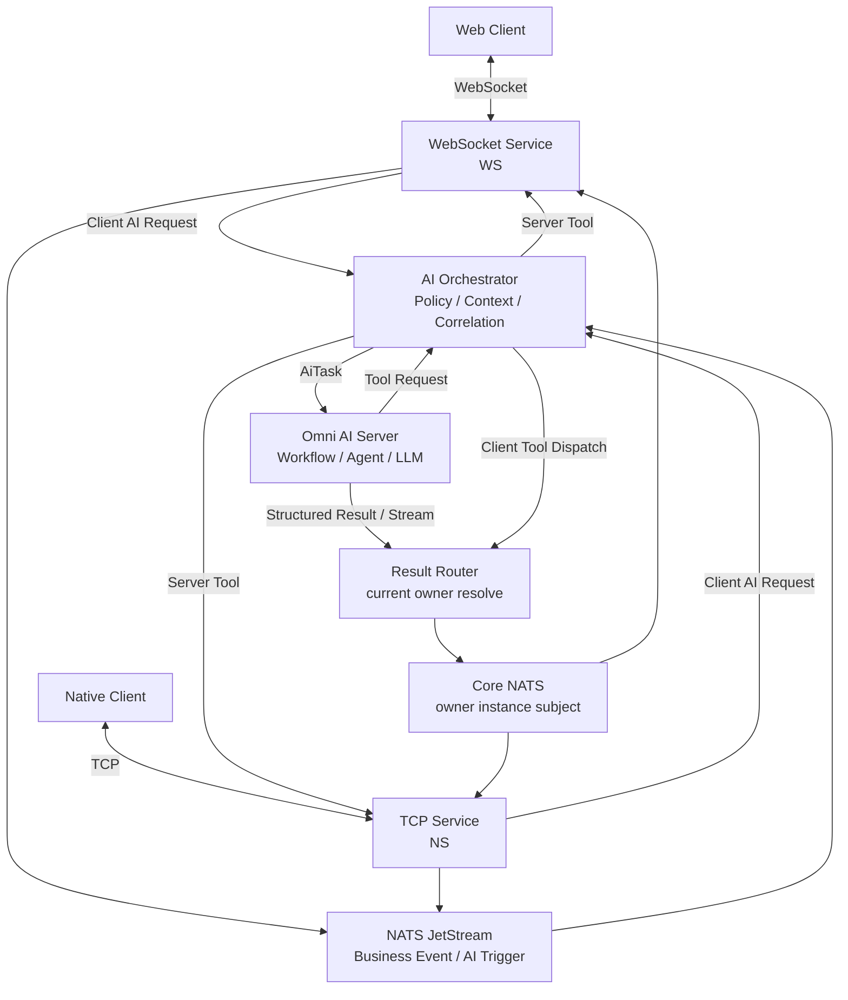

# Omni AI Platform

> **Messenger가 이미 알고 있는 Business Event, User State와 Business Data를 AI 실행의 시작점으로 확장하고, WebSocket 및 TCP Client가 공통으로 사용할 수 있는 AI 실행 플랫폼을 설계한다.**


## Why Omni AI?

기존 Messenger AI는 `/요약`, `/번역`, `/질문`처럼 사용자가 상황을 파악하고 기능을 직접 호출하는 방식이 중심이다. 그러나 Messenger Backend는 이미 사용자의 업무 흐름을 설명하는 정보를 가지고 있다.

- 사용자가 어떤 대화방에 들어왔는가
- 자리비움에서 언제 복귀했는가
- 어떤 메시지와 업무 이벤트가 발생했는가
- 어떤 사용자·조직·권한·연결 상태가 적용되는가

Omni AI는 이 정보를 단순한 LLM 입력으로만 사용하지 않는다. **Messenger가 AI가 필요한 순간을 판단하고, 허용된 Context를 구성해 적절한 실행과 전달 방식으로 연결하는 것**을 목표로 한다.

```text
Business Event / User State / Business Data / User Request
  → Messenger Business Logic
  → AI execution decision
  → Context-aware AI
  → Suggestion / Message / Push / Navigation
```

### Representative Use Cases

| 상황 | 사용자 결과 | 확장되는 실행 구조 |
| --- | --- | --- |
| 사용자가 대화방에 진입 | 현재 대화에 적합한 시작 문장 추천 | 방 session, 지연 실행, 취소, 오래된 결과 차단 |
| 사용자가 자리비움에서 복귀 | 부재중 수신 메시지의 발신자·업무 주제 Digest | 상태 변경 Trigger, Cross-domain Context, 중복 방지 |
| 사용자가 반복 요약 일정을 등록 | 지정 시각에 주간보고 요약 메시지 수신 | Schedule 검증, 회차 관리, 오프라인 보류와 재개 |

이 세 흐름은 각각 [Conversation Start](docs/use-cases/01-conversation-start.md), [Returned Message Topics](docs/use-cases/02-returned-message-topics.md), [Scheduled Weekly Report](docs/use-cases/03-scheduled-weekly-report.md)에서 다룬다.

## Architecture Direction

이 프로젝트는 현재 배포된 Messenger 구조를 출발점으로 `AI Orchestrator`와 `Omni AI Server`를 연결한다. Web Client는 `WebSocket Service (WS)`, 기존 Native Client는 `TCP Service (NS)`를 통해 접속한다. 두 서비스를 포괄하는 논리적 경계를 `Messenger Client Ingress`라고 부른다.

아래 그림은 **Accepted ADR을 반영한 Target Architecture**다. 현재 구현은 Conversation Start REST ingress, 메모리 Repository와 Scheduler, REST Result Delivery를 사용하며, JetStream Trigger, 공통 AiTask, Tool Runtime과 Core NATS Result Delivery는 단계적으로 연결한다. 실제 구현 경계는 [Current Implementation Status](#current-implementation-status)와 [Server Trigger](docs/components/ai-orchestrator/server-trigger.md)를 기준으로 확인한다.



### Core Responsibilities

| Component | Owns | Does not own |
| --- | --- | --- |
| **AI Orchestrator** | Trigger·Feature Policy, Context Assembly, AiTask, execution correlation, Conversation Metadata, Tool lifecycle, Result Routing coordination | Domain source of truth, realtime connection, LLM prompt와 runtime history |
| **Omni AI Server** | Workflow·Agent 실행, Prompt, LLM 호출, Tool decision, Conversation History, Runtime State | Messenger topology, 인증 정책, Client session, channel별 전달 |
| **Messenger Client Ingress** | `WebSocket Service (WS)`와 `TCP Service (NS)`의 connection/session, 인증된 Client context, 소유한 상태 전이와 Business Event 확정, Client protocol ingress·delivery | Cross-domain AI 기능 실행 정책, execution lifecycle, Workflow와 LLM 실행 |

상세한 전체 책임표와 실행 축은 [Architecture Overview](docs/overview.md)에서 확인할 수 있다.

## Key Design Decisions

### 1. Business Event와 AiTask를 분리한다

`USER_RETURNED`는 Presence owner가 자신이 소유한 상태를 기준으로 확정한 사실이고, `RETURNED_MESSAGE_TOPICS`는 AI가 수행할 작업이다. AI Orchestrator는 복귀 상태 전이를 재구성하지 않고, source-confirmed Event에 AI 기능 정책을 적용한다. Business Event가 발생해도 정책을 통과한 경우에만 AiTask를 생성한다.

### 2. Domain과 connection의 Source of Truth를 유지한다

사용자·메시지·파일·Presence 상태는 현재 그 기능을 구현한 Messenger Service가 소유한다. WebSocket connection은 `WebSocket Service (WS)`, TCP connection은 `TCP Service (NS)`가 소유한다. AI Orchestrator는 여러 경계를 조정하지만 원본 상태를 복제해 소유하지 않는다.

### 3. Messenger Application과 AI Runtime을 분리한다

AI Orchestrator는 제품 정책과 실행 correlation을 담당하고, Omni AI Server는 Prompt·Workflow·Agent 실행에 집중한다. 이를 통해 Python AI Runtime이 Messenger topology와 인증 규칙에 직접 결합되지 않게 한다. 자세한 근거는 [ADR 003](docs/decisions/003-ai-orchestrator-application-service.md)에 기록한다.

### 4. Trigger와 realtime 결과 전달의 통신 특성을 분리한다

재처리가 필요한 Business Event는 NATS JetStream으로 전달하고, LLM Stream과 실행 결과는 현재 connection owner를 조회한 뒤 Core NATS로 전달한다. reconnect와 scale-out 이후에도 Trigger 당시 instance가 아니라 현재 owner를 기준으로 routing한다. 자세한 결정은 [ADR 001](docs/decisions/001-session-registry-result-routing.md)과 [ADR 005](docs/decisions/005-websocket-realtime-client-session-result-routing.md)를 따른다.

### 5. Tool lifecycle은 AI Orchestrator가 소유한다

Omni AI Server는 필요한 Tool을 선택하지만 schema validation, permission, timeout, retry, dispatch와 result normalization은 AI Orchestrator의 Tool Runtime이 관리한다. Server Tool과 Client Tool은 같은 lifecycle을 사용하고 실행 위치만 adapter로 분리한다. 자세한 근거는 [ADR 002](docs/decisions/002-tool-runtime-ownership-client-tool-dispatch.md)에 기록한다.

전체 결정 요약과 개별 ADR은 [Architecture Decisions](docs/decisions/README.md)에서 관리한다.

## Current Implementation Status

현재 우선 구현 대상은 **Phase 1: Conversation Start End-to-End**이며 상태는 `In Progress`다.

현재 AI Orchestrator에는 다음 흐름이 구현되어 있다.

- `WebSocket Service (WS)` 또는 `TCP Service (NS)`가 호출하는 Conversation Start REST API
- 동일 `roomSessionId` 요청의 멱등 처리
- 같은 사용자·방의 이전 실행 취소와 새 실행 예약
- 프로세스 내부 Scheduler를 이용한 지연 실행
- 실행 직전 configured tenant Global AI Policy 확인
- Omni AI Server의 `TRENDING` 추천 HTTP 호출
- 응답 correlation 확인과 실행 상태 전이
- Redis에서 현재 Realtime connection owner를 확인한 뒤 해당 instance의 REST endpoint로 결과 전달

아직 남은 주요 작업은 다음과 같다.

- 최근 메시지와 Presence를 포함하는 실제 Context Assembly
- Feature·User Policy, cooldown과 공통 Trigger Policy 연결
- `tenantId`와 `clientSessionId`를 요청 body가 아닌 검증된 인증 context에서 routingRef에 연결
- 공통 `AiTask` 및 `triggerId / taskId / executionId` correlation
- 메모리 Repository와 Scheduler의 durable·distributed 구현
- REST Result Delivery를 계획된 Core NATS owner-instance 전달로 교체
- 결과 전달 실패 retry와 실행 결과 조회 API
- Enter Room부터 Client Suggestion까지의 전체 E2E 검증

Phase별 상태와 완료 조건의 기준 문서는 [Roadmap](docs/roadmap.md) 한 곳이다. Phase 1의 구현 경계는 [Server Trigger](docs/components/ai-orchestrator/server-trigger.md)에서 실제 코드 구조를 기준으로 기록한다.

## Documentation

처음 읽는 경우 `Overview → Roadmap → 관심 Use Case` 순서를 권장한다.

| 알고 싶은 내용 | 문서 |
| --- | --- |
| 전체 구조와 책임 경계 | [Architecture Overview](docs/overview.md) |
| 구현 순서와 현재 상태 | [Roadmap](docs/roadmap.md) |
| 사용자 기능의 End-to-End 흐름 | [Use Cases](docs/use-cases/README.md) |
| 서비스별 실제 구현 구조 | [Components](docs/components/README.md) |
| 확정된 설계 결정과 Trade-off | [Architecture Decisions](docs/decisions/README.md) |
| 공통 메시지·식별자 계약과 확정 상태 | [Common Contracts](docs/contracts/README.md) |
| Server Business Event 실행 모델 | [Server-driven AI](docs/concepts/server-driven-ai.md) |
| AiTask, Queue와 routing 계약 | [AiTask and Queue](docs/concepts/ai-task-and-queue.md) |
| Client Tool과 Context 경계 | [Client Tool Integration](docs/concepts/client-integration.md) |
| 현재 Messenger 서비스 경계와 용어 | [Current Service Boundary](docs/concepts/current-service-boundary.md) |

```text
docs/
├── overview.md          # 전체 아키텍처의 기준 문서
├── roadmap.md           # 구현 순서와 상태의 기준 문서
├── concepts/            # 실행 모델과 주요 개념
├── contracts/           # 공통 메시지·식별자 계약과 확정 상태
├── decisions/           # ADR와 결정 요약
├── use-cases/           # 사용자 결과 중심의 E2E Vertical Slice
├── components/          # 서비스별 공통 구현 책임
└── troubleshooting.md  # 문제 해결 기록
```

## Documentation Rules

- 시스템 전체 책임과 흐름은 `overview.md`에 기록한다.
- Business Event의 성립 조건과 source owner의 확정 책임을 AI 기능 실행 정책과 분리해 기록한다.
- `Trigger Policy`는 source-owned 상태 전이를 재판정하는 규칙이 아니라, 확정된 Event를 AI 기능으로 전환하는 규칙으로 표현한다.
- 되돌리기 어려운 결정과 대안은 ADR로 기록한다.
- 공통 메시지와 식별자의 기준 이름·확정 상태는 `contracts/`에서 관리하고, 상세 결정은 연결된 ADR을 참조한다.
- 기능 고유 흐름, AI 입출력과 완료 조건은 해당 Use Case에 기록한다.
- 여러 Use Case가 공유하는 구현 구조만 Component 문서에 기록한다.
- Use Case의 우선순위와 상태는 `roadmap.md`에서 관리한다.

### Status Convention

| Document type | Status |
| --- | --- |
| Roadmap / Use Case | `Planned → In Progress → Implemented` 상태의 기준은 Roadmap 한 곳이다. |
| Component | `Planned → In Progress → Implemented` 실제 구현과 검증 수준을 나타낸다. |
| ADR | `Proposed → Accepted → Superseded` 결정의 승인 상태를 나타낸다. |
| Architecture / Concept | 상태를 표시하지 않고 Current와 Target을 본문에서 명시한다. |
