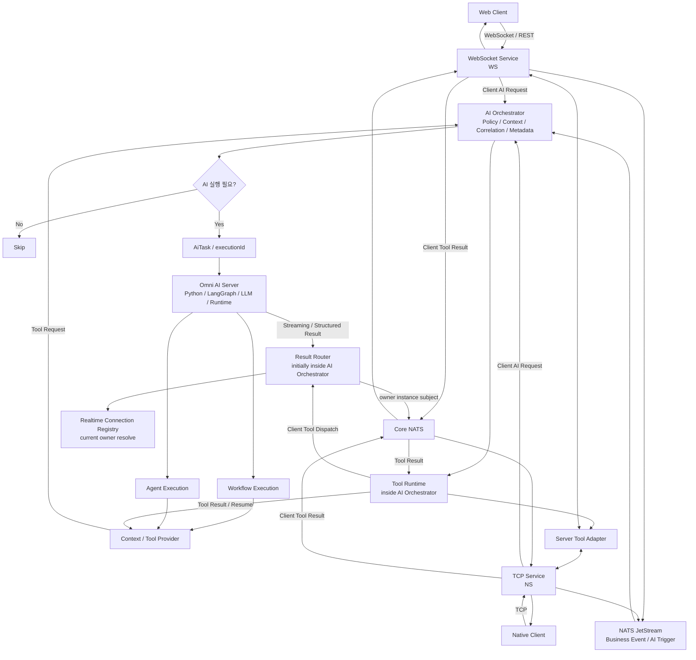

# Architecture

> Role: 전체 시스템 구조, Layer별 책임, 실행 방식과 Provider 축을 설명하는 기준 문서
> 이 문서는 README의 구조를 확장해 Omni AI Platform의 전체 책임 분리와 실행 흐름을 설명한다. 운영 구현 완료를 의미하지 않는다.

---

## 1. Architecture Goal

Omni AI Platform은 Messenger의 Business Event와 Client Request를 AI 실행 후보의 진입점으로 삼고, `AI Orchestrator`와 `Omni AI Server`의 책임을 분리하는 구조를 목표로 한다.

현재 Messenger Backend에서 Web Client는 `WebSocket Service (WS)`, 기존 Native Client는 `TCP Service (NS)`에 연결된다. `WebSocket Service`는 WebSocket 연결과 현재 Messenger Business Logic을 함께 처리하고, `TCP Service`는 Native Client의 TCP connection/session과 protocol ingress·delivery를 처리한다. 두 물리 서비스를 포괄하는 논리적 경계는 `Messenger Client Ingress`다.

각 현재 Messenger Service는 자신이 구현한 Business State와 Policy의 Source of Truth를 유지한다. `AI Orchestrator`는 확정된 Business Event와 Context를 조합해 AI Use Case를 조정하고, `Omni AI Server`는 실행이 확정된 Task에 대해 Workflow 또는 Agent 방식으로 AI 처리를 수행한다. 서비스 분리·통합을 가정한 미래 배포 구조는 이 프로젝트의 범위에 포함하지 않는다.

---

## 2. Target High-level Flow

아래 흐름은 Accepted ADR과 현재 설계 방향을 합친 Target Architecture다. 현재 구현은 Conversation Start REST ingress, 메모리 실행 저장소·Scheduler와 owner instance REST Result Delivery를 사용한다. 구현 완료 범위는 [Roadmap](roadmap.md)과 [Server Trigger](components/ai-orchestrator/server-trigger.md), [Result Router](components/ai-orchestrator/result-router.md)를 기준으로 확인한다.




---

## 3. Responsibility

아래 책임표는 현재 배포 구조를 기준으로 한다.

| Layer | Responsibility |
| --- | --- |
| WebSocket Service (WS) | Web Client의 WebSocket connection/session, 인증된 Client context, 현재 WebSocket Service에 구현된 Chat / Note / Alert / User / Presence / Auth / File / REST Business Logic, WebSocket delivery |
| TCP Service (NS) | Native Client의 TCP connection/session, legacy protocol와 `connectType` 해석, TCP request ingress·delivery, 소유한 Client 상태 전이 확정 |
| Messenger Client Ingress | `WebSocket Service (WS)`와 `TCP Service (NS)`를 포괄하는 논리적 경계. 별도 배포 서비스가 아님 |
| NATS JetStream | 재처리가 필요한 Business Event / AI Trigger 전달, durable consumer, ACK / retry |
| AI Orchestrator | Cross-domain AI Use Case 조정, Trigger Policy, Context Assembly, Cooldown / Dedup, Execution Correlation, Conversation Metadata, Tool Runtime. 초기에는 Result Router module을 내부 배치 |
| Omni AI Server | Workflow / Agent 실행, Prompt / LangGraph / LLM / Tool Decision, Conversation History / Runtime State |
| Tool Runtime | `AI Orchestrator` 내부 책임. Tool registry, schema validation, permission, lifecycle, dispatch, timeout, retry, result normalization, execution resume 조정 |
| Server Tool Adapter | Tool Runtime의 server-side adapter. Server-side context / tool 요청을 현재 해당 Business Logic을 소유한 Messenger Service로 중계 |
| Client Tool Integration | Client Context / Client Tool을 `Omni AI Server`에 연결하는 Provider 계층 |
| Client Tool Delivery | `WebSocket Service (WS)` 또는 `TCP Service (NS)` 내부 책임. Result Router가 선택한 instance의 local session lookup, client protocol delivery, Client Tool result ingress |
| Result Router | `routingRef` 해석, Realtime Connection Registry의 현재 owner 조회, owner instance subject publish. 초기에는 AI Orchestrator 내부 module이며 이후 분리 가능 |
| Realtime Connection Registry | `WebSocket Service (WS)`와 `TCP Service (NS)`가 등록한 현재 connection / room session / owner instance 조회. WebSocket / TCP session 자체를 소유하지 않음 |
| Core NATS / Realtime Delivery | Result Router가 선택한 owner instance로 LLM Streaming, Execution Progress, Client Tool dispatch를 저지연 전달 |

---

## 4. Core Separation

### Business Event와 AiTask

```text
USER_RETURNED
= 무슨 일이 발생했는가

RETURNED_MESSAGE_TOPICS
= AI가 무엇을 수행해야 하는가
```

Business Event가 발생했다고 해서 항상 AiTask가 생성되는 것은 아니다. Business Policy를 통과해 `EXECUTE`가 확정된 경우에만 AiTask가 만들어진다.

Business Event의 성립 여부는 해당 상태의 Source of Truth인 현재 Business owner가 판단한다. 예를 들어 `USER_RETURNED`는 `Messenger Client Ingress` 내부의 Presence owner가 인증된 connection context, `AWAY/OFFLINE → ONLINE` 전이, `offlineSince`, `returnedAt`, `absencePeriodId`를 확정한 Event다. `AI Orchestrator`는 이 상태 전이를 다시 추론하지 않고, source identity, 필수 필드, 시간 구간 정합성 같은 Event contract를 검증한 뒤 기능·사용자·만료·중복·Context 정책을 적용해 AI 실행 여부를 판단한다.

Single-domain AI Use Case는 해당 Service에서 직접 처리할 수 있다. Cross-domain AI Use Case는 `AI Orchestrator`에서 여러 Service의 Context를 조합한다.

현재 `WebSocket Service (WS)`가 여러 Business responsibility를 함께 가지고 있는 경우에도 원칙은 동일하다. `AI Orchestrator`는 명시적인 Port나 API를 통해 현재 해당 책임을 소유한 Messenger Service와 연동하며, 이 프로젝트에서는 이를 미래의 개별 서비스 이름으로 미리 분해해 표현하지 않는다.


### Service Ownership과 AI Orchestrator

`AI Orchestrator`는 Messenger Application 영역의 Coordination Boundary이다.

```text
WebSocket Service
→ WebSocket / Chat / Note / Alert / Realtime Delivery

TCP Service
→ TCP Connection / Session / Realtime Delivery

Messenger Client Ingress
→ WebSocket Service (WS) + TCP Service (NS)의 공통 AI ingress / delivery 경계

AI Orchestrator
→ Trigger Policy / Cross-domain Context Assembly / Execution Correlation / Conversation Metadata / Tool Runtime / Result Routing

Omni AI Server
→ Prompt / Workflow / LangGraph / LLM Execution / Tool Decision / Conversation History / Agent State
```

`AI Orchestrator`는 사용자 상태, 메시지 상태, 인증 상태, 파일 상태의 Source of Truth가 아니다. 각 상태는 현재 해당 기능을 구현한 Messenger Service가 소유하고, AI Orchestrator는 명시적인 Port나 API를 통해 조회한다. `AI Orchestrator`가 직접 DB / Redis를 사용하는 범위는 cooldown, deduplication, execution correlation, conversation metadata처럼 자신이 소유한 실행 조정 상태로 제한한다.


### Channel Boundary와 공통 AI 실행 규격

`WebSocket Service (WS)`와 `TCP Service (NS)`는 각자의 connection, session, delivery 책임을 유지한다.

Source owner가 자신이 소유한 상태 전이와 Business Event를 확정한다. 그 Event를 특정 AI 기능으로 전환하는 실행 판단, AI Trigger Policy, Context Assembly, AiTask 생성, Execution Correlation은 AI Orchestrator에서 공통화한다.

```text
WebSocket Client
→ WebSocket Service
→ AI Orchestrator
→ Omni AI Server

Native Client
→ TCP Service (NS)
→ AI Orchestrator
→ Omni AI Server
```

이 구조는 WebSocket 경로와 TCP 경로가 동일한 AI Use Case, 요청 / 응답 규격, executionId 기반 correlation을 사용하게 한다. AI 기능이 늘어나도 `WebSocket Service (WS)`와 `TCP Service (NS)`에 policy를 중복 구현하지 않는다.


### Conversation Metadata와 Runtime State

`AI Orchestrator`는 Messenger Product 기능에 필요한 Conversation Metadata를 관리한다.

```text
conversationId
userId
tenantId
workflowType
title
createdAt
updatedAt
status
archived
access policy
```

`Omni AI Server`는 다음 LLM 추론에 필요한 Runtime State를 관리한다.

```text
User Turn
Assistant Turn
Conversation History
Conversation Summary
LangGraph Checkpoint
Tool State
Agent State
Prompt Context
```

WebSocket Session은 `WebSocket Service`가 관리하는 Network Connection이고, AI Conversation은 `conversationId` 기준의 Logical Conversation이다. reconnect가 발생해도 `conversationId`는 유지될 수 있다.


### Conversation Query Model

Conversation list는 Product Metadata 조회이므로 `AI Orchestrator`가 Metadata Store에서 직접 응답한다.

```text
Client
→ AI Orchestrator REST API
→ Conversation Metadata Store
→ Client
```

Conversation detail history는 `AI Orchestrator`가 ownership / tenant / access policy를 확인한 뒤 `Omni AI Server`에 동기 조회한다.

```text
Client
→ AI Orchestrator REST API
→ access check
→ Omni AI Server
→ Conversation History Store
→ AI Orchestrator
→ Client
```

`AI Orchestrator`는 access gate와 response envelope을 담당하고, user / assistant turn history의 owner는 `Omni AI Server`로 둔다.


### Execution Mode와 Provider

Client Tool Integration은 Workflow / Agent와 같은 실행 방식이 아니다. Workflow와 Agent는 실행 방식이고, Client Tool Integration은 Context나 Tool을 제공하는 계층이다.

```text
Execution Mode
├─ Workflow Execution
└─ Agent Execution

Context / Tool Provider
└─ Tool Request via AI Orchestrator Tool Runtime
```

Server Tool과 Client Tool 모두 어떤 Tool이 필요한지 판단하는 주체는 `Omni AI Server`다. Tool lifecycle의 owner는 `AI Orchestrator`의 Tool Runtime이고, 실제 실행 위치만 adapter와 delivery path로 분리한다.

```text
Tool Decision
= Omni AI Server

Tool Lifecycle
= AI Orchestrator Tool Runtime

Server Tool Execution
= AI Orchestrator Tool Runtime → Server Tool Adapter → 현재 Business owner

Client Tool Execution
= AI Orchestrator Tool Runtime → Result Router → Realtime Connection Registry에서 routingRef 기준 현재 ownerInstanceId 조회 → Core NATS owner-instance subject → Messenger Client Ingress의 현재 connection owner → local connection → Client
```


---

## 5. AI Function Models

### Server-driven AI

```text
현재 Business Event owner
→ NATS JetStream
→ AI Orchestrator
→ Omni AI Server
→ Core NATS
→ Messenger Client Ingress의 현재 connection owner
→ Client
```

Trigger는 Server Business Event이고, 실행은 One-shot이며, 결과는 Realtime Push로 전달한다.


### Client-driven Command

```text
Client
→ Messenger Client Ingress
→ AI Orchestrator
→ Omni AI Server
→ Core NATS
→ Messenger Client Ingress의 현재 connection owner
→ Client
```

Trigger는 `/요약`, `/일정`, `/번역` 같은 명시적 Client Request이고, 실행은 One-shot이며, 결과는 Streaming으로 전달한다.


### Stateful Chatbot

```text
Client
→ Messenger Client Ingress
→ AI Orchestrator
→ Omni AI Server
→ Core NATS
→ Messenger Client Ingress의 현재 connection owner
→ Client
```

Trigger는 `conversationId + message`이고, 실행은 Multi-turn이며, State는 Conversation State다.


---

## 6. Execution Modes

### Workflow Execution

필요한 Context와 처리 순서가 비교적 명확한 기능에 사용한다.

```text
AiTask
→ Context Resolution
→ Workflow
→ AI Processing
→ Structured Result
```

대표 예:

- Conversation Start Recommendation
- Returned Message Topic Digest
- Scheduled Weekly Report Summary
- Label 기반 분류 / 요약


### Agent Execution

실행 도중 다음 단계나 Tool 사용 여부를 AI가 동적으로 결정하는 기능에 사용한다.

```text
AiTask
→ Agent Runtime
→ Tool Decision
→ Tool Call
→ Tool Result
→ Agent Resume
→ Final Result
```

Agent Execution의 핵심은 Client를 사용한다는 점이 아니라, Runtime 중 Tool 사용 여부와 다음 단계를 동적으로 결정한다는 점이다.


---

## 7. Communication

통신 방식은 하나로 통일하지 않고 역할에 따라 구분한다.

```text
Business Event / AI Trigger
= NATS JetStream

Control Path
= Client / Messenger Client Ingress → AI Orchestrator → Omni AI Server

Streaming Data Path
= Omni AI Server → Result Router → Realtime Connection Registry 조회 → Core NATS → Messenger Client Ingress → Client

Execution Progress Path
= Omni AI Server → Result Router → Realtime Connection Registry 조회 → Core NATS → Messenger Client Ingress → Client

Tool Control Path
= Omni AI Server → AI Orchestrator Tool Runtime

Server Tool Dispatch
= AI Orchestrator Tool Runtime → 현재 Business owner

Client Tool Dispatch
= AI Orchestrator Tool Runtime → Result Router → Realtime Connection Registry 조회 → Core NATS → Messenger Client Ingress → Client

Client Tool Result
= Client → Messenger Client Ingress → Core NATS → AI Orchestrator Tool Runtime → Omni AI Server resume
```

통일하는 대상은 Transport가 아니라 실행 계약과 식별자다. `executionId`, `conversationId`, `connectionId`, `roomSessionId` 등의 역할 분리는 목표 방향이지만, 전체 식별자 모델은 아직 [ADR 004](decisions/004-ai-execution-and-context-identifiers.md)가 `Proposed` 상태이므로 확정 계약처럼 해석하지 않는다. 현재 계약 확정 상태와 공통 명칭은 [Common Contracts](contracts/README.md)를 따른다.

`AI Orchestrator`가 관리하는 Control Path:

```text
executionId
conversationId
workflow
policy
correlation
routing context
tool lifecycle
```

`Omni AI Server`가 생성하고 Result Router가 전달할 Stream Event 후보:

```text
START
STATUS
DELTA
PROGRESS
COMPLETED
FAILED
```

`Result Router`는 `routingRef`로 Realtime Connection Registry를 조회하고, 현재 `ownerInstanceId`의 Core NATS subject를 선택한다. Core NATS는 registry lookup을 수행하지 않고 선택된 subject의 event만 전달한다. `WebSocket Service (WS)`와 `TCP Service (NS)`는 해당 event를 각자의 client protocol로 변환해 자신이 소유한 local connection에 전달한다.

Client Tool request / response는 Tool Runtime을 data path로 사용한다. `Omni AI Server`가 tool call을 결정하면 `AI Orchestrator`의 Tool Runtime이 lifecycle과 routingRef를 생성한다. Result Router가 Realtime Connection Registry에서 현재 ownerInstanceId를 조회해 Core NATS owner-instance subject를 선택하고, 선택된 `WebSocket Service (WS)` 또는 `TCP Service (NS)`의 Client Tool Delivery가 local connection으로 전달한 뒤 결과를 Tool Runtime으로 반환한다.

LLM token stream과 execution progress는 Tool Runtime을 통과하지 않는다. Tool Runtime은 `tool_started`, `tool_progress`, `tool_completed`, `tool_failed`, `tool_timeout` 같은 Tool lifecycle event를 관리한다. 초기에는 AI Orchestrator 내부 Result Router가 routing만 수행하며, 고빈도 token stream을 Client까지 proxy하지 않는다. 필요해지면 동일한 `ResultEvent` 계약을 유지한 채 Result Router를 독립 Realtime Delivery Plane으로 분리한다.


---

## 8. Result Routing

Trigger 당시 `WebSocket Service` instance와 Result 전달 시점의 instance가 같다고 가정하지 않는다.

AI 처리 중 다음 상황이 발생할 수 있다.

```text
Reconnect
Scale-out
Scale-in
Instance Restart
Session Migration
```

최종 Routing 시점에는 현재 Session Owner를 기준으로 전달한다. `enterRoom`이나 Client explicit request를 처리한 instance는 correlation 정보로만 보고, `connectionId` / `roomSessionId`를 통해 Realtime Connection Registry에서 현재 `ownerInstanceId`를 resolve한다. 특정 Client 종류로 전달을 제한하는 Use Case는 Messenger Client Ingress가 검증한 선택적 `routingRef.connectionType`을 함께 저장하고, Result Router가 현재 connection record와 일치하는지 확인한다. Result Router는 owner instance subject를 선택할 뿐 session을 소유하지 않으며, 선택된 `WebSocket Service (WS)` 또는 `TCP Service (NS)`가 local connection으로 최종 push한다.


---

## 9. Further Design Topics

다음 항목은 현재 Messenger 배포 구조 안에서 진행할 후속 설계 범위이며, 구현 우선순위와 진행 상태는 [Roadmap](roadmap.md)에서 관리한다.

- Stateful Chatbot과 장기 Conversation lifecycle
- Agent Runtime과 반복 Tool Calling
- Workload별 Queue / Worker 분리
- AI Context Projection과 Cache
- Observability, Evaluation과 Execution Budget
